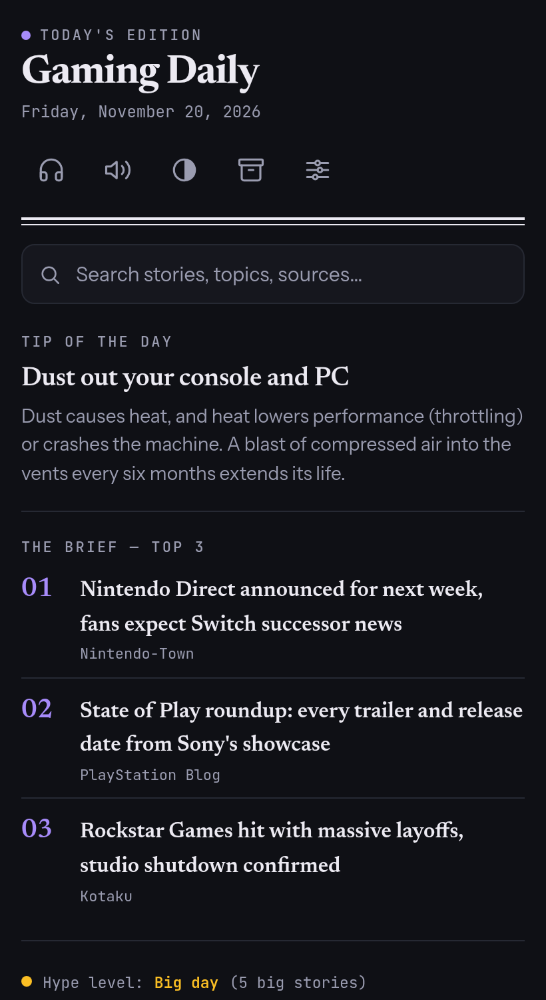

# Gaming Daily

A daily 100% video-game magazine: news, consoles, PC, modding & retro, esports. On Windows, Android, Linux and iPhone.

The app pulls articles from 29 outlets (French and English) through their public RSS feeds, strips ads, translates non-English stories to English, and shows each article in full, right inside the app. No account, no ads, no server.



Light theme: [docs/screenshot-light.png](docs/screenshot-light.png). The screenshots use sample articles.

## Features

- Built-in reader: the full article is extracted from its original page and reformatted, with a link back to the source.
- Bilingual UI (English / French) with a language picker in Settings; notifications and text-to-speech follow it.
- Automatic translation of non-English sources into the selected language.
- Five categories: News, Consoles, PC, Modding & retro, Esports.
- Search, offline favorites, read stories greyed out, estimated reading time.
- Tracked topics: related stories float to the top and are highlighted.
- Duplicate stories clustered across outlets.
- Hype of the day: flags big announcements (Nintendo Direct, State of Play, buyouts, delays, leaks).
- A few-line summary at the top of each article, tap-to-define glossary, quiz of the day.
- Podcast mode and text-to-speech.
- Archives of the last 7 days, light and dark themes.
- Update banner when a new version is released.

## Install

All files are in the [latest release](https://github.com/wk0t/GamingDaily/releases/latest).

**Windows.** Run `GamingDaily.exe`: today's magazine opens in the browser. Optional: `powershell -File GamingDaily.ps1 -Lang fr` to generate the French edition directly. SmartScreen may warn because the executable is unsigned (More info, then Run anyway). To open it every morning at 8 AM, run `enable-autostart.ps1`.

**Android.** Download `GamingDaily.apk`, open it and allow installation from this source. Android 7.0 or newer.

**Linux.** Download `GamingDaily-x86_64.AppImage`, then:

```bash
chmod +x GamingDaily-x86_64.AppImage
./GamingDaily-x86_64.AppImage
```

**iPhone.** The `.ipa` is provided unsigned and has not been tested on a real device. Sign it with your Apple ID via [AltStore](https://altstore.io) or [Sideloadly](https://sideloadly.io). With a free account, the app expires after 7 days.

## Updates

At startup, the app compares its version to the latest release tag of this repository. If a newer version exists, a banner appears:

- Android: the APK is downloaded, then the installer launches.
- Windows, Linux, iPhone: the banner opens the release page.

Nothing is downloaded without your action on Windows, Linux and iPhone.

## Build it yourself

| Target | Tools |
|---|---|
| Windows | PowerShell 5.1 and .NET Framework, already in Windows |
| Android | JDK 17, Android SDK build-tools 34, platform android-34 |
| Linux | Node 20 and electron-builder |
| iPhone | macOS, Xcode 16, XcodeGen |

```powershell
# Windows: embeds the PowerShell engine into a .exe launcher
./build_exe.ps1

# Android: aapt, javac, d8, zipalign, apksigner, no Gradle
cd android
./build_apk.ps1
```

```bash
# Linux
cd linux && npm install && npm run dist

# iPhone (macOS)
cd ios && cp ../android/assets/index.html GamingDaily/index.html && cp -r ../android/assets/fonts GamingDaily/fonts && xcodegen generate
```

Linux and iOS are also built by GitHub Actions (`.github/workflows/build.yml`).

On the first Android build, a `android/gamingdaily.jks` key is generated. Keep it: Android refuses an update signed with a different key. It is excluded from the repo by `.gitignore`.

## Structure

```
GamingDaily.ps1     PC engine: fetches the feeds, extracts, translates, generates the page
build_exe.ps1       builds GamingDaily.exe
enable-autostart.ps1 / disable-autostart.ps1   open the magazine every morning (Windows)
android/            web UI (assets/index.html) + native Java bridge
linux/              Electron app reusing the same UI
ios/                WKWebView app reusing the same UI
docs/               screenshots
```

The UI is a single file, `android/assets/index.html`, reused on Android, Linux and iOS (fonts in `android/assets/fonts/`). Each platform provides a native bridge for what the browser cannot do alone: CORS-free requests, text-to-speech, sharing, updates.

## Privacy

No server, no account, no statistics. Favorites, history and settings stay on your device. The only outgoing connections are the outlets' RSS feeds, Google's free translation service for non-English stories, and this repo's Releases API.

## Sources

jeuxvideo.com, Gamekult, ActuGaming, Gameblog, JVFrance, IndieMag, NoFrag, PlayStation Blog, Xbox Wire, Nintendo-Town, XboxSquad, Gamergen, Frandroid Gaming, IGN, GameSpot, Eurogamer, Kotaku, Polygon, VGC, Destructoid, Insider Gaming, PC Gamer, Rock Paper Shotgun, Push Square, Nintendo Life, Pure Xbox, Wololo, Time Extension, RetroRGB.

Every story keeps a link to its source. Texts, images and trademarks belong to their respective owners. Personal project, not affiliated with these outlets.

## License

[MIT](LICENSE). Article content is not covered by this license.
